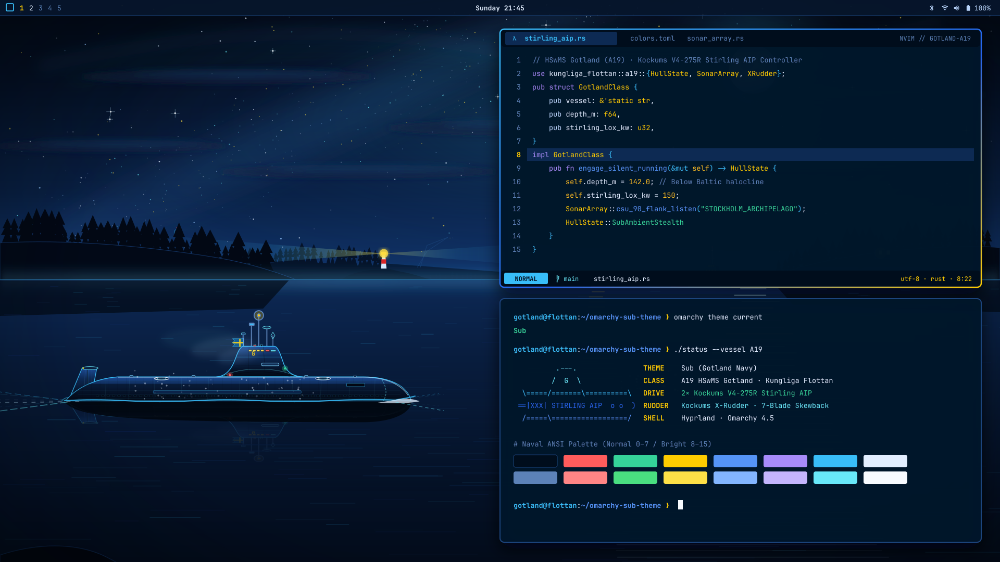
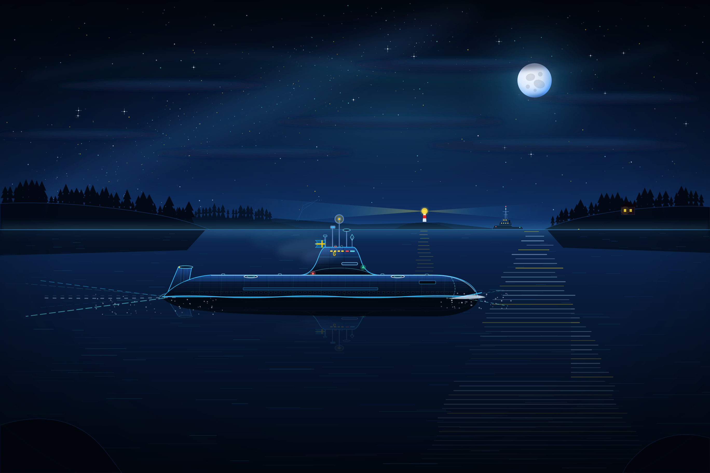
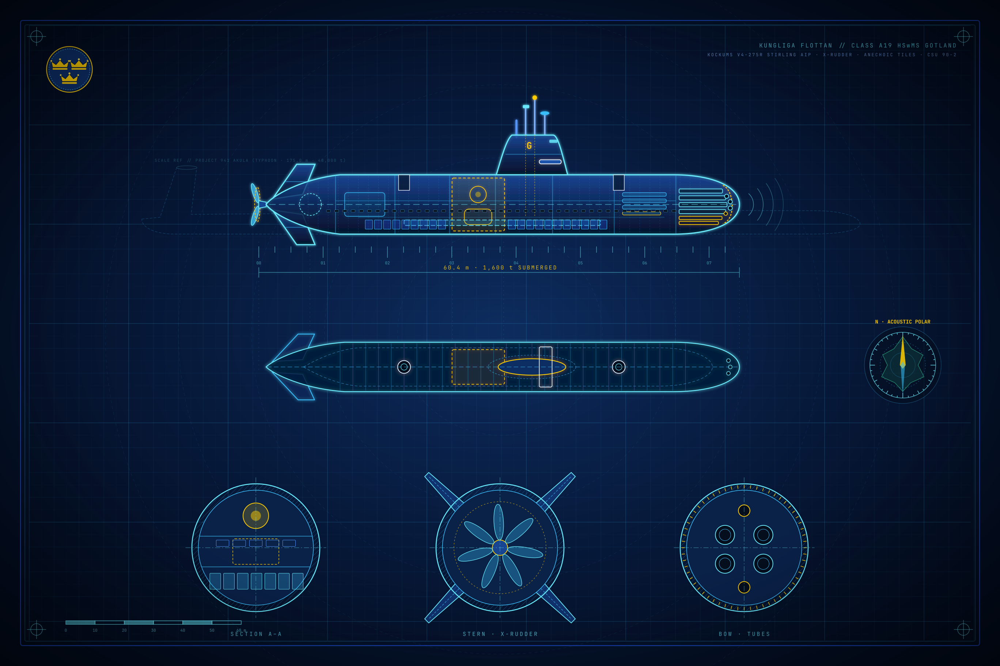
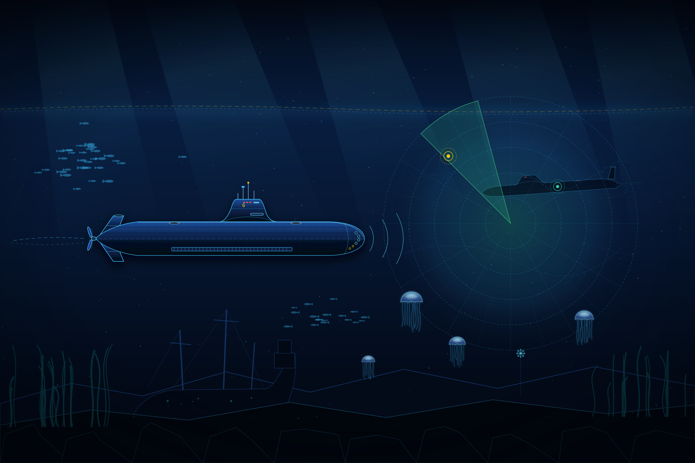
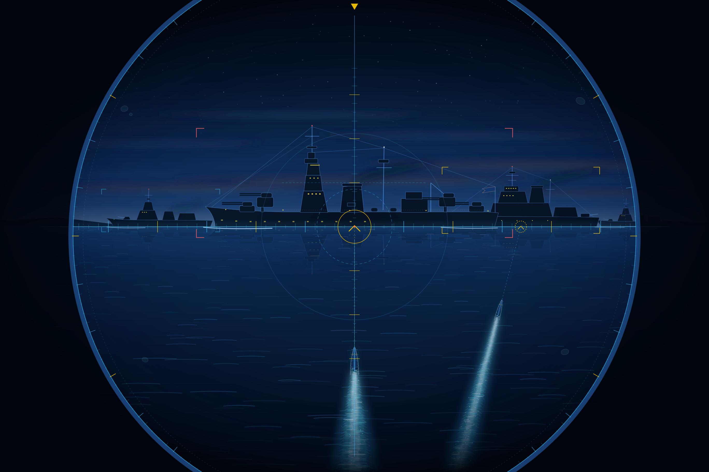

# Omarchy Sub Theme (`omarchy-sub-theme`) ⚓🇸🇪

**Swedish Navy (*Kungliga Flottan*) · HSwMS Gotland (A19) · Deep Baltic Navy Blue, Sonar Cyan & Swedish Gold.**

A dark [Omarchy](https://omarchy.org/) desktop theme inspired by [SubWrite](https://subwrite.se) and [TechTools](https://techtools.subwrite.se), paying tribute to Sweden's legendary **Gotland-class (A19) Stirling AIP submarine (`HSwMS Gotland`)**.

<p align="center">
  
</p>

---

## Install

Install and apply directly with the Omarchy CLI:

```bash
omarchy theme install https://github.com/sgt-nylle/omarchy-sub-theme.git
```

### Theme & Wallpaper Commands

```bash
# Re-apply the theme at any time
omarchy theme set sub

# Cycle between the 4 included Gotland-class backgrounds (or press Super + Ctrl + Space)
omarchy theme bg next

# Update all Git-installed Omarchy themes
omarchy theme update

# Remove the theme
omarchy theme remove sub
```

---

## Four Gotland-Class Backgrounds (`2736×1824`)

All four custom wallpapers are rendered at native `2736×1824` (3:2 Retina / Widescreen friendly) and free of distracting text boxes so your terminal and windows stay clean and readable:

<table>
  <tr>
    <td width="50%" align="center">
      <a href="backgrounds/01-stockholm-archipelago-night-patrol.png">
        
      </a>
      <br><b>01 · Stockholm Archipelago Night Departure (Default)</b>
      <br><i>HSwMS Gotland</i> sailing out on the surface at night through <i>Stockholms skärgård</i> in deep Cold War bluedark steel &amp; anechoic tile detail — featuring lower-hull free-flooding limber slots, sculpted turtleback sail fairings, white escape-trunk deck rings, cold exhaust mist drifting past the bridge, a naval escort tug with lattice radar mast, distant Muskö shipyard cranes, and a silver-blue cratered moon.
    </td>
    <td width="50%" align="center">
      <a href="backgrounds/02-hms-gotland-tactical-blueprint.png">
        
      </a>
      <br><b>02 · HSwMS Gotland (A19) Naval Intelligence Blueprint</b>
      <br>Deep bluedark naval engineering &amp; intelligence plate with internal torpedo reload skids, battery &amp; Stirling AIP compartments, escape trunks, acoustic polar signature rose, a ghosted Cold War Project 941 Typhoon (<i>Red October</i>, 175 m) scale comparison profile, and three cross-sections (<code>SECTION A–A</code>, <code>STERN · X-RUDDER</code>, and <code>BOW · TUBES</code>).
    </td>
  </tr>
  <tr>
    <td width="50%" align="center">
      <a href="backgrounds/03-baltic-sonar-silent-running.png">
        
      </a>
      <br><b>03 · Baltic Thermocline — Silent Running (<i>Hunt for Red October</i> Vibe)</b>
      <br>Deep abyssal bluedark cat-and-mouse scene below the halocline: <i>HSwMS Gotland</i> in full anechoic-tiled stealth trim with red-rigged conn windows and CSU 90-2 flank hydrophone staves pinging a massive Project 941 Typhoon-class submarine lurking in the distant sonar shadow above a sunken warship and tethered naval mine.
    </td>
    <td width="50%" align="center">
      <a href="backgrounds/04-dawn-torpedo-run.png">
        
      </a>
      <br><b>04 · Periscope Convoy Torpedo Salvo (Cold War Bluedark Twilight)</b>
      <br>Attack periscope view in moody Cold War bluedark twilight with optical lens condensation droplets and stadia rangefinding crosshairs locked onto a 4-ship naval surface group as a two-torpedo <i>Torped 62</i> salvo streaks submerged beneath the dark-blue swell.
    </td>
  </tr>
</table>

---

## Color Palette (`colors.toml`)

Every Omarchy 4.5 surface (Hyprland borders, Quickshell bar, menus, launcher, lock screen, Alacritty/Ghostty/Kitty/Foot terminals, Neovim, VS Code, `btop`, and GTK/icons) is generated from `colors.toml`:

| Role | Token | Hex | Description |
| :--- | :--- | :--- | :--- |
| **Background** | `background` | `#07162c` | Deep Baltic Navy CIC Surface |
| **Dark Background** | `dark_background` | `#040e1d` | Abyssal Navy Trench |
| **Darker Background** | `darker_background` | `#020812` | Keel Black-Navy Scrim |
| **Elevated Surface** | `lighter_background` | `#0f2b52` | Elevated Navy Card / Cursor Line |
| **Foreground** | `foreground` | `#e2eeff` | Crisp Naval Readout White-Blue |
| **Bright Foreground** | `bright_foreground` | `#f8fbff` | Periscope Glint Peak White (Cursor) |
| **Muted / Hairline** | `muted` / `hairline` | `#5b82b8` / `#1b457d` | Steel-Navy Comments & Frame Borders |
| **Primary Accent** | `accent` / `cyan` | `#38bdf8` / `#67e8f9` | Periscope & Sonar Telemetry Cyan |
| **Selection** | `selection` | `#164682` | Tactical Navy Selection Highlight |
| **Yellow / Gold** | `yellow` / `bright_yellow` | `#fecc02` / `#fde047` | Swedish Naval Ensign Gold (*Örlogsflagga*) |
| **Blue** | `blue` / `bright_blue` | `#5494f7` / `#82b5ff` | Royal Swedish Navy Blue |
| **Green** | `green` / `bright_green` | `#34d399` / `#4ade80` | Passive Sonar Contact Green |
| **Red** | `red` / `bright_red` | `#ff5c5c` / `#ff8585` | SubWrite Torpedo / Red Alert |
| **Magenta** | `magenta` / `bright_magenta` | `#a78bfa` / `#c4b5fd` | ESM / Acoustic Intercept Violet |

### Included Theme Assets
- `colors.toml` — Complete Omarchy 4.5 semantic token & 16-slot ANSI palette
- `shell.bar.toml`, `shell.controls.toml`, `shell.lock.toml`, `shell.launcher.toml`, `shell.menu.toml`, `shell.popups.toml`, `shell.tooltip.toml` — Coordinated Navy Blue Quickshell bar, menus, and lock screen
- `icons.theme` — `Yaru-blue` icon theme selection
- `unlock.png` & `preview-unlock.png` — Custom `HSwMS Gotland (A19)` lock/unlock emblem
- `backgrounds/` — 4 original `2736×1824` PNG wallpapers

---

## License

Released under the [MIT License](LICENSE). Created by [sgt-nylle](https://github.com/sgt-nylle) ([subwrite.se](https://subwrite.se) / [techtools.subwrite.se](https://techtools.subwrite.se)).
